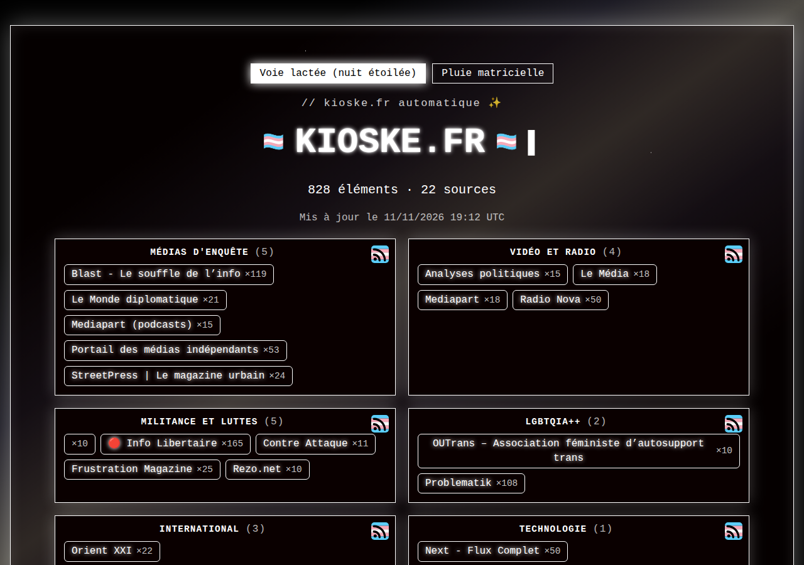
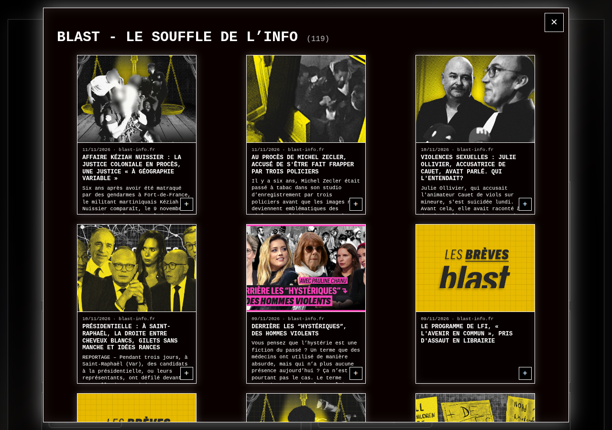

# kioske.fr

Le **KiosKe** : une veille automatique des médias indépendants, des luttes et des voix LGBTQIA+.
Une seule page statique (HTML5, CSS et JavaScript minimal), reconstruite toutes les 30 minutes sur
le serveur à partir de flux RSS et de chaînes Twitch. Les images sont hébergées par le site : la page
ne charge rien d'un autre site, sans publicité ni pistage.

**Mots-clés** : kioske, veille, médias indépendants, LGBTQIA+, Mélenchon, RSS, Twitch, informatique libre.

En haut de la page, le **bloc immuable** (cagnotte, lien Discord, code de conduite) n'est jamais
modifié par le build.

> Projet autonome depuis le 2026-11-11 (copie de `gauchiasses.fr`), réorganisé le même jour : code
> dans le paquet `kioske/`, site généré dans `build/`, réglages dans `kioske.cfg`.
> **À vérifier :** l'`origin` du dépôt git pointe encore vers `kit-gauchiasses.fr`.
>
> **Modifications (2026-11-12)** : menu "+" en haut à gauche avec barre de recherche, choix des thèmes, lien Discord et charte. Layout compacté. Étiquettes tronquées (20 chars max). Navigation Précédent/Suivant en galerie. Zoom PC supprimé.

<p align="center"></p>

Cliquer sur une étiquette ouvre la fenêtre de la source, avec une carte par article. Cliquer sur une
carte ouvre l'article dans la page (texte du flux, lien vers l'original).

<p align="center"></p>

## Sommaire

1. [Structure](#structure)
2. [Réglages : `kioske.cfg`](#réglages--kioskecfg)
3. [Construire et publier](#construire-et-publier)
4. [Sources de la veille](#sources-de-la-veille)
5. [Bloc immuable](#bloc-immuable)
6. [La page](#la-page)
7. [Données, caches et images](#données-caches-et-images)
8. [Déploiement sur le serveur](#déploiement-sur-le-serveur)
9. [Référencement](#référencement)
10. [Limites](#limites)
11. [Licences](#licences)

## Structure

| Fichier / dossier | Rôle |
| --- | --- |
| `kioske.cfg` | **Tous les réglages** : domaine, thèmes, veille, serveur. Lu par Python et par les scripts bash. |
| `sources/` | Ce que la veille suit : `RSS_feeds.txt`, `Twitch_feeds.txt`, `flux_corrige_main.txt`. Écrits à la main. |
| `accueil/bloc_immuable.html` | Source du bloc immuable. |
| `static/` | Fichiers publiés tels quels : `favicon.svg`, `apple-touch-icon.png`, `preview.png`, `fonts/`. |
| `kioske/` | Le code (paquet Python) et les feuilles de style `style.css`, `pluie.css`. Voir ci-dessous. |
| `bin/` | Points d'entrée : `build_site.py`, `publier_public.py`, `garde_immuable.py`. Quelques lignes chacun. |
| `deploy/` | Scripts du serveur : `kioske.sh` (point d'entrée), `installer_serveur.sh`, `deployer_nginx.sh`, `verifier_serveur.sh`, `lib_config.sh`, `systemd/`, `fail2ban/`. |
| `data/` | `immuable.json` (empreinte du bloc, suivie par git) ; `historique.db`, `cache/`, `build.lock` (locaux, jamais publiés). |
| `build/` | **Le site généré**, complet : `index.html`, `rss.xml`, `rss/`, `img/veille/`, copie de `static/`, `robots.txt`, `sitemap.xml`. Hors git, jamais édité à la main, jamais envoyé au serveur. |
| `requirements.txt` | Dépendances Python (`feedparser`, `yt-dlp`, `legacy-cgi`). |
| `apercu/preview.svg` | Source de `static/preview.png` (image de partage social) : générer avec `rsvg-convert -w 1200 -h 630 apercu/preview.svg -o static/preview.png`. |
| `docs/img/` | Captures de ce README. |
| `old/` | Sauvegardes et reliquats (hors git, non synchronisés). `old/reliquats-2026-11-11/` : anciens scripts FTP et systemd ; `old/avant-reorganisation-2026-11-11.tar.gz` : le projet avant la réorganisation. |

Le paquet `kioske/` :

| Module | Rôle |
| --- | --- |
| `config.py` | Chemins du projet et valeurs de `kioske.cfg`. Aucun autre module n'écrit de chemin en dur. |
| `sources.py` | Lecture des fichiers de `sources/` (flux, chaînes, réglages locaux, catégories). |
| `flux.py`, `twitch.py`, `apercus.py`, `reseau.py` | Récupération : flux RSS, vidéos Twitch (yt-dlp), aperçus Open Graph. |
| `images.py` | Téléchargement des images dans `build/img/veille/`, et purge de celles qui ne servent plus. |
| `historique.py` | Base SQLite de tout ce qui a été récupéré. |
| `themes.py`, `style.css`, `pluie.css` | Thèmes et CSS de la page. |
| `rendu.py`, `rss.py`, `texte.py` | HTML de la page, flux RSS produits, outils de texte. |
| `immuable.py` | Garde du bloc immuable. |
| `verrou.py` | Un seul build ou une seule publication à la fois. |
| `construction.py`, `publication.py` | Le build (`build/`) et la copie vers la racine web. |

## Réglages : `kioske.cfg`

Format INI, commenté dans le fichier. Une valeur manquante ou invalide arrête le build avec un message.

| Section | Clés |
| --- | --- |
| `[site]` | `domaine`, `nom`, `slogan` (titre de l'onglet et référencement), `theme` (thème par défaut), `taille_defaut` (zoom initial en %, min 75, max 125, défaut 100). |
| `[veille]` | `articles_flux_rss` (100), `videos_par_chaine` (15), `articles_par_source` (0 = tous), `delai_nouvel_essai_heures` (24). |
| `[serveur]` | `racine_web` (`/var/www/kioske.fr`), `ip_publique`, `intervalle_timer` (`30min`). |
| `[theme.<nom>]` | `nom`, `fond` (`etoiles` ou `noir`), `pluie` (`oui` ou `non`), `opacite_panneau` (0 à 100, en %). |

Deux thèmes existent : `voie_lactee` (fond noir étoilé, bande de la Voie lactée) et `pluie` (pluie
matricielle). Ajouter une section `[theme.<nom>]` ajoute un bouton de choix sur la page.

Les scripts bash lisent les mêmes valeurs avec `cfg <section> <clé>` (`deploy/lib_config.sh`).
Après un changement de `intervalle_timer` ou de `racine_web`, relancer `deploy/installer_serveur.sh`.

## Construire et publier

Le Python est toujours celui du venv du projet : `venv_blog/` sur le PC, `venv/` sur le serveur.

```bash
python3 -m venv venv_blog && venv_blog/bin/pip install -r requirements.txt   # une fois

venv_blog/bin/python bin/build_site.py                 # build complet : flux, Twitch, aperçus, images, page, flux RSS
venv_blog/bin/python bin/build_site.py --simple        # page seule, sans réseau (base et caches), flux RSS non réécrits
venv_blog/bin/python bin/build_site.py --no-twitch     # sans Twitch
venv_blog/bin/python bin/build_site.py --no-previews   # sans visiter les pages (rapide)
venv_blog/bin/python bin/build_site.py --no-cache      # ignore les caches
```

Le résultat est dans `build/` : ouvrir `build/index.html` dans un navigateur suffit pour le voir.

La publication copie `build/` dans la racine web (`racine_web`). Elle se lance **sur le serveur** :

```bash
venv/bin/python bin/publier_public.py                # construit, puis copie (ce que fait le timer)
venv/bin/python bin/publier_public.py --simple       # construit sans réseau, puis copie
venv/bin/python bin/publier_public.py --sans-build   # copie build/ tel quel
```

- Seuls les fichiers dont le contenu a changé sont copiés ; la dernière ligne donne le compte.
- Les images et flux de catégorie qui ne sont plus dans `build/` sont retirés de la racine web.
- Le build et la publication partagent un verrou (`data/build.lock`) : un lancement manuel pendant le
  passage du timer attend la fin de l'autre au lieu d'écrire les mêmes fichiers.

**Changer le thème ou la mise en page sans toucher aux articles** : `kioske_update` depuis le PC, puis
sur le serveur `venv/bin/python bin/publier_public.py --simple`. Un build seul ne publie rien.

## Sources de la veille

Dans `sources/`. Une ligne `[Nom]` seule ouvre une catégorie ; les flux ou chaînes qui suivent y vont,
jusqu'à la ligne `[…]` suivante. Une source sans catégorie tombe dans le bloc « Des Liens », en dernier.

```text
[Médias d'enquête]
"https://portail.basta.media/spip.php?page=backend"
[Twitch]
"ostpolitik"
```

- `RSS_feeds.txt` est une **copie** de la liste du bot Discord : si l'une des deux change, recopier l'autre.
- `Twitch_feeds.txt` est **propre à ce projet** (même format que celle du bot, mais indépendante).
- `flux_corrige_main.txt` : réglages locaux. `!"URL"` ignore un flux, `"URL" | Nom` change son nom
  affiché (flux RSS seulement). Pas de commentaire en fin de ligne. Un flux qui ne fournit pas de
  titre donne une étiquette vide (seulement « ×10 ») : lui donner un nom ici, comme pour
  `agauche.org` (« À gauche »). Le nom apparaît au build complet suivant, pas avec `--simple`.
- Une source présente dans deux catégories garde la première. Les étiquettes sont regroupées par URL :
  un flux renommé n'apparaît qu'une fois.

## Bloc immuable

`accueil/bloc_immuable.html` contient le bloc entre `<!-- IMMUABLE:DEBUT -->` et `<!-- IMMUABLE:FIN -->`.
Le build l'insère tel quel. Deux contrôles :

1. la source doit correspondre à l'empreinte de `data/immuable.json` ;
2. la page générée doit contenir le bloc **à l'identique**, avant et après son écriture, et encore
   avant la publication.

```bash
venv_blog/bin/python bin/garde_immuable.py verifier      # échoue si le bloc a changé
venv_blog/bin/python bin/garde_immuable.py enregistrer   # accepte la version actuelle (après une modif voulue)
```

Tant que l'empreinte n'est pas réenregistrée après une modification, rien n'est écrit ni publié.

## La page

- **Thème au choix du visiteur** : deux boutons au-dessus de « // kioske.fr automatique ». Boutons
  radio cachés et règles `:root:has(#theme-<id>:checked)` : CSS seul, sans JavaScript ni cookie. Le
  choix ne dure que la visite. Sans `:has()` (vieux navigateurs), seul le thème par défaut s'affiche.
- **Barre de recherche** : champ texte sous les thèmes. Appuyez sur Entrée pour filtrer les cartes :
  celles qui correspondent restent opaques (100%) et cliquables, les autres deviennent semi-transparentes
  (30%) et non-cliquables. Cherche dans les titres, descriptions, sources et dates. La page scroll
  automatiquement vers les résultats.
- **Galerie horizontale** : sous le bloc immuable, les 10 derniers articles ayant une image, affichés en
  ligne avec images seulement (80 × 80 px). Scroll horizontal pour plus d'articles. Clic sur une image
  ouvre la fiche complète de l'article. Boutons Précédent/Suivant pour naviguer entre articles de la galerie.
- **Lien GitHub** : en bas de la page, lien vers le dépôt du projet avec mention de la licence (GPL v3).
- **Étiquettes** : une par source, dans un bloc par catégorie.
  Clic sur une étiquette → fenêtre de source avec backdrop cliquable pour fermer. Les flux RSS (par catégorie et global) restent découvrables dans le code source pour les agrégateurs.

- **Cartes d'articles** : format «carte à jouer» (ratio 2.5:3.5) avec image fixe en haut (35% de la hauteur), contenu scrollable au milieu, boutons de navigation en bas. Structure flexbox uniforme pour tous les articles.
- **Navigation** : boutons Précédent/Suivant pour naviguer dans les articles d'une même source, ou entre articles de la galerie, sans recharger la page. Position de scroll préservée au retour à une source.
- **Fermeture** : croix (×) ou clic en dehors du panneau pour fermer l'article et revenir à la fenêtre source (ou à l'accueil pour la galerie). Clic en dehors de la fenêtre source → retour à l'accueil.
- **Backdrops** : fond noir semi-transparent (70%) autour des panneaux, cliquable pour fermer et revenir au niveau précédent. Évite les clics accidentels.
- **Téléphone** (640 px et moins) : une carte par ligne, image en haut, seul le titre est affiché ; les
  étiquettes passent à la ligne ; les fenêtres ont la largeur du panneau principal.
- **Grand écran** (1100 px et plus) : `zoom: 1.25`, fenêtres de catégorie sur trois colonnes, blocs de
  catégories sur deux colonnes dès 900 px. Largeur et hauteur des fenêtres sont divisées par 1,25 pour
  tenir dans l'écran.
- **Lisibilité** : cartes, fenêtres et panneaux d'article opaques ; seul le grand panneau principal est
  translucide (`opacite_panneau`). Pas de halo sur les textes courants ; halo réduit sur le titre. Les
  étiquettes ne clignotent pas.

Le CSS est dans `kioske/style.css` (et `kioske/pluie.css`), inséré dans la page au build. Celui du bloc
immuable est dans `accueil/bloc_immuable.html`.

## Données, caches et images

- **`data/historique.db`** (SQLite, table `articles`) : tout ce qui a été récupéré. Rien n'y est effacé
  automatiquement. La page affiche les articles des sources **encore listées** : retirer une ligne de
  `sources/` cache ses articles sans les supprimer. `articles_par_source` limite l'affichage sans
  toucher à la base. Un flux injoignable ne fait rien disparaître.
- **`data/cache/`** : `previews_cache.json` (aperçus), `twitch_cache.json`, `images_echecs.json`. Une
  page ou une image en échec est réessayée après `delai_nouvel_essai_heures`.
- **Images** : téléchargées dans `build/img/veille/` sous un nom dérivé de leur adresse. JPEG, PNG,
  WebP, GIF et AVIF seulement (pas de SVG), 5 Mo au maximum. Les images qu'aucun article affiché
  n'utilise plus sont supprimées à chaque build.
- **Flux RSS produits** : `build/rss.xml` (les 100 articles les plus récents) et un flux par catégorie
  dans `build/rss/`, avec le texte complet de chaque article.

## Déploiement sur le serveur

Le site est construit et servi par le serveur (Debian 13, nginx). Le projet vit dans
`/home/meli/kioske.fr`, la racine servie est `racine_web`.

**Depuis le PC** : la fonction fish `kioske_update` (rsync avec `--delete`).

```bash
kioske_update --dry-run    # ce qui serait envoyé
kioske_update              # envoi vers meli@zarisse.fr:/home/meli/kioske.fr/
```

Elle n'envoie ni `build/`, ni `data/historique.db`, ni `data/cache/`, ni les venvs, ni `old/`,
`docs/`, `apercu/`, `.git/`, `CLAUDE.md`.

**Sur le serveur**, en utilisateur normal (`meli`) ; les étapes qui en ont besoin demandent `sudo` :

```bash
deploy/kioske.sh                          # tout, dans l'ordre
deploy/kioske.sh --email toi@exemple.fr   # tout, et demande le certificat Let's Encrypt
deploy/kioske.sh veille                   # seulement la mise à jour (ce que lance le timer)
deploy/kioske.sh --simulation             # affiche sans rien lancer
```

| Étape | Ce qu'elle fait |
| --- | --- |
| `immuable` | Vérifie l'empreinte du bloc immuable. |
| `serveur` | `installer_serveur.sh` : venv, racine web, unités systemd, premier passage. |
| `veille` | `publier_public.py` : construit `build/` puis le copie dans la racine web. |
| `nginx` | `deployer_nginx.sh` : HTTP, puis HTTPS si le certificat existe. Options `--email`, `--sans-certificat`. |
| `fail2ban` | Page « Tu es banni » et jail `kioske-scan`. Ignorée si la jail `sans_pitie` manque. |
| `statut` | `verifier_serveur.sh` : DNS, nginx, HTTPS, certificat, timer, âge de la dernière publication. |

**Service** : le timer `kioske-veille` lance `deploy/kioske.sh veille` à l'intervalle de `kioske.cfg`.
Les modèles sont dans `deploy/systemd/` ; `installer_serveur.sh` y remplace l'utilisateur, le dossier,
la racine web et l'intervalle. Le service tourne sous `meli` (`Group` = son groupe principal, calculé
par `id -gn "$UTILISATEUR"`), avec `SupplementaryGroups=www-data`, `UMask=0002` et
`ExecStartPost=+chown -R www-data:www-data` sur la racine web.

```bash
systemctl list-timers kioske-veille.timer
journalctl -u kioske-veille.service -n 50
sudo systemctl start kioske-veille.service   # publier tout de suite
```

**Droits** : la racine web est en `www-data:www-data`, dossiers `2775`, fichiers `664`. `data/` et
`build/` appartiennent à l'utilisateur du service.

**nginx** (`deploy/deployer_nginx.sh`) : HTTPS seul avec HSTS, **TLS 1.3 seul**, 0-RTT refusé, version
masquée, méthodes `GET` et `HEAD`, fichiers cachés refusés, en-têtes de sécurité, politique de contenu
`default-src 'none'` (images, styles et polices du site seulement, aucun script). Le script teste la
configuration et remet l'ancienne si elle est invalide. Le certificat couvre le domaine seul, sans `www`.

**fail2ban** (`deploy/fail2ban/`) : `f2b.sh` (copie de `~/fail2ban_hardened/f2b.sh`), filtre
`kioske-scan.conf` (fichiers cachés, PHP, WordPress, `/cgi-bin/`), jail `kioske-scan.jail.conf`
(5 scans en 10 minutes, ban d'un jour). Débannir : `sudo fail2ban-client set kioske-scan unbanip <IP>`.

**Domaines alternatifs** : `gauchiasse.org` et `gauchiasses.org` redirigent vers `kioske.fr` (301).
Le script est dans `~/Lenovo_scripts/redirections_gauchiasses.sh`, à lancer en root sur le serveur.

### Après la réorganisation du 2026-11-11

1. `kioske_update --dry-run`, puis `kioske_update`.
2. Sur le serveur : `bash deploy/installer_serveur.sh`. Il déplace l'ancien `img/` dans `build/img/`,
   réinstalle les unités systemd et lance un passage.
3. Vérifier : `bash deploy/verifier_serveur.sh`.
4. Retirer ensuite l'exclusion `/img/` de `kioske_update`.

## Référencement

Le titre et la description de la page décrivent son contenu réel : `nom` et `slogan` de `kioske.cfg`,
nombre de sources et noms des catégories du jour. La page a une adresse canonique, des balises Open
Graph et Twitter (image `preview.png`), un `robots.txt` et un `sitemap.xml`. Chaque flux RSS est
déclaré dans l'en-tête.

## Limites

- Un flux injoignable est ignoré avec un message `[flux] …` ; la page est construite sans lui.
- Twitch passe par yt-dlp. Une vidéo réservée aux abonnés ou supprimée est ignorée avec un message.
- Les aperçus viennent de la page de l'article ; certains sites ne fournissent pas d'image.
- La base n'est jamais purgée : sans `articles_par_source`, la page grossit avec le temps.
- Ne pas mettre dans la veille une ressource dont le nom se résout en adresse privée
  (ex. `blog.zarisse.fr` depuis le réseau local) : Chrome demande alors l'accès au réseau local.

## Licences

**kioske.fr** : GNU General Public License v3 (`LICENSE`). Vous pouvez copier, modifier et distribuer ce projet
sous les termes de la GPL v3.

Articles et vidéos de la veille : leurs auteur.ice.s et sites respectifs. Police Russo One : SIL Open
Font License (`static/fonts/OFL.txt`).
