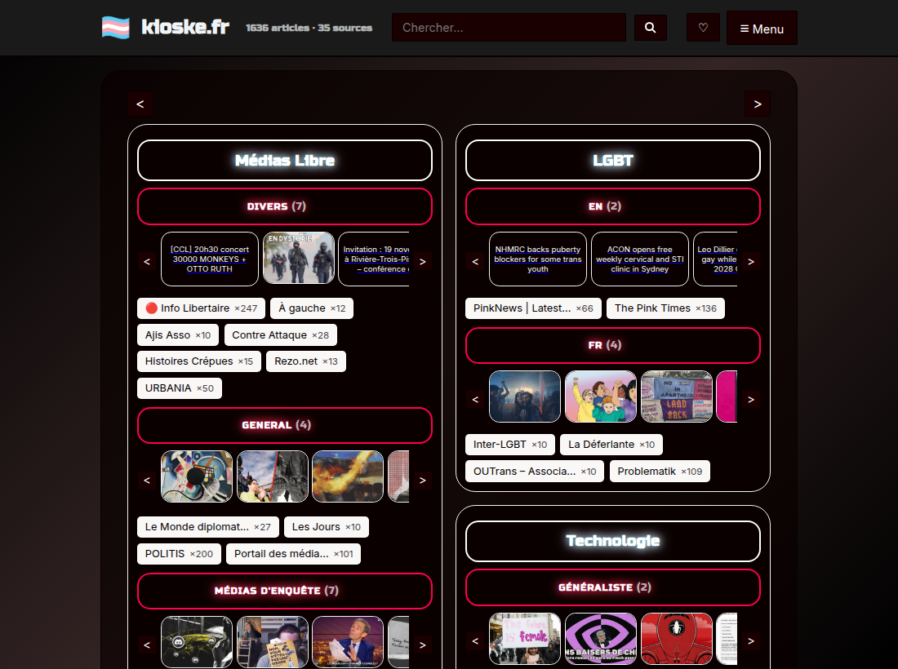
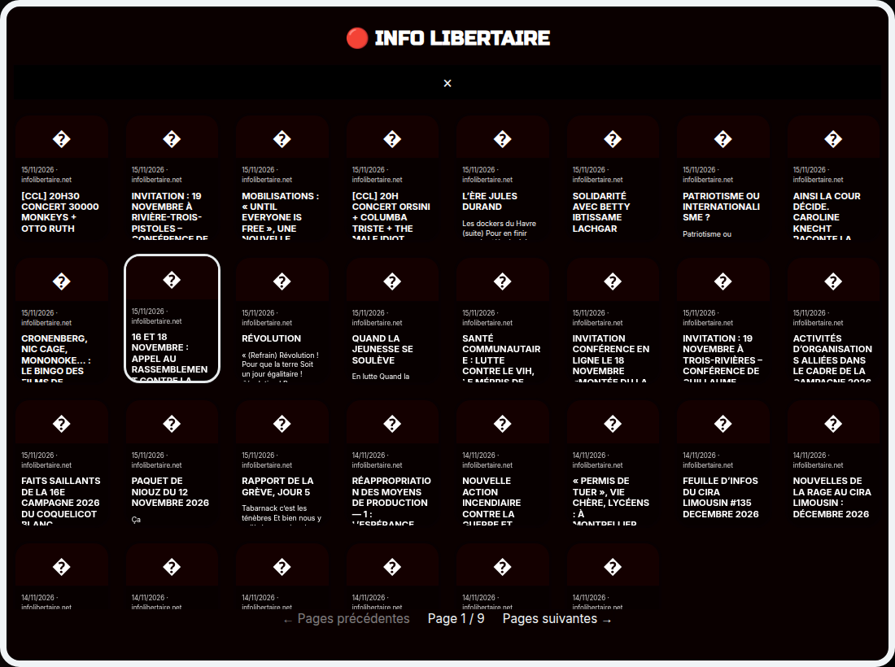
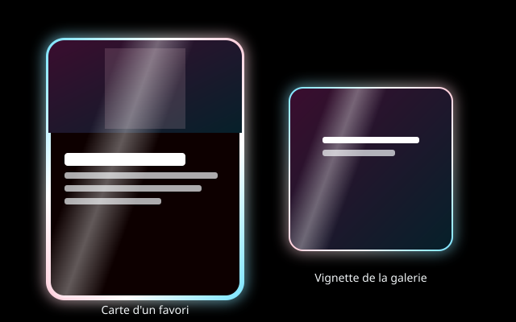

# kioske.fr — 1.2.0

Le **KiosKe** : une veille automatique des médias indépendants, des luttes et des voix LGBTQIA+.
Pages HTML statiques (HTML5, CSS, JavaScript sans dépendance) générées toutes les 30 minutes sur le serveur
à partir de flux RSS et de chaînes Twitch. Une page d'accueil + une page par catégorie + une page par article
(plus de mille pages). Les images des articles sont chargées depuis le site d'origine de chaque source (l'adresse de l'image,
sans copie chez nous) ; les cartes de partage sont composées et stockées sur le site. Pas de publicité. Le JavaScript sert à la navigation (panneaux, cartes, recherche, favoris) ; sans
lui, les pages statiques d'articles et de catégories restent lisibles par leurs liens.

**Langue** : le site et le projet sont en français — pages (`lang="fr"`), flux RSS, code, commentaires
et documentation.

**Mots-clés** : kioske, veille, médias indépendants, LGBTQIA+, RSS, Twitch, informatique libre.


Projet autonome depuis le 2026-11-11, réorganisé depuis : code dans le paquet `kioske/`, site généré dans `build/`, réglages dans `kioske.cfg`. Voir l'historique git pour les modifications détaillées.

<p align="center"></p>

Cliquer sur une étiquette ouvre le panneau de la source, avec une carte par article. Cliquer sur une
carte ouvre l'article par-dessus la page, au format « carte à jouer » (texte du flux, lien vers l'original).

<p align="center"></p>

### Aperçu : effet shiny

Les cartes des favoris, les vignettes de la grande galerie et la carte ouverte ont un **effet shiny** : un halo aux couleurs du thème, une bordure en dégradé qui tourne et un reflet qui balaie la carte en continu (4 s). Il est défini dans `kioske/style_favoris.css`, et il se coupe avec « réduire les animations ».

<p align="center"></p>

L'image est une capture figée : l'animation se voit dans la page.

## Sommaire

1. [Structure](#structure)
2. [Réglages : `kioske.cfg`](#réglages--kioskecfg)
3. [Tests](#tests)
4. [Construire et publier](#construire-et-publier)
5. [Sources de la veille](#sources-de-la-veille)
6. [La page](#la-page)
7. [Données, caches et images](#données-caches-et-images)
8. [Déploiement sur le serveur](#déploiement-sur-le-serveur)
9. [Référencement](#référencement)
10. [PWA (Progressive Web App)](#pwa-progressive-web-app)
11. [Limites](#limites)
12. [Licences](#licences)

## Structure

| Fichier / dossier | Rôle |
| --- | --- |
| `kioske.cfg` | **Tous les réglages** : domaine, thèmes, veille, serveur. Lu par Python et par les scripts bash. |
| `sources/` | Ce que la veille suit : `RSS_feeds.txt`, `Twitch_feeds.txt`, `flux_corrige_main.txt`. Écrits à la main. |
| `static/` | Fichiers publiés tels quels : `404.html` (page d'erreur, servie par nginx pour toute adresse inexistante), `dispositions-legales.html` (mentions légales, liée en bas de l'accueil ; emplacements à compléter), `favicon.svg`, `apple-touch-icon.png`, `preview.png`, `fonts/` (Russo One pour les titres et la navigation, Inter pour le texte courant ; chemins absolus `/fonts/…` dans les CSS, pour que les pages d'article et de catégorie les trouvent), `theme.js` (thème choisi par le visiteur, pluie matricielle et mode sobre, sur toutes les pages), `style_sobre.css` (feuille du mode sobre, chargée seulement quand il est activé), `sw.js` et `manifest.json` (PWA), icônes `icon-*.png`. |
| `kioske/` | Le code (paquet Python), la feuille de style `style.css`, les squelettes HTML des pages (`gabarits/`) et leur JavaScript (`js/`). Voir ci-dessous. |
| `tests/` | Tests du site, lancés sur le PC par `bash tests/lancer.sh` (voir « Tests »). |
| `outils/` | Outils locaux, jamais envoyés au serveur. `parametres_gui.py` : fenêtre pour régler `kioske.cfg` (tkinter, bibliothèque standard). Lancement : `venv_blog/bin/python outils/parametres_gui.py`. Commentaires du fichier conservés, copie `kioske.cfg.bak` avant chaque enregistrement. `cfg_editeur.py` : la logique (lecture, validation, écriture), testée par `tests/test_python.py`. |
| `bin/` | Points d'entrée : `build_site.py`, `publier_public.py`. Quelques lignes chacun. |
| `deploy/` | Scripts du serveur : `kioske.sh` (point d'entrée), `installer_serveur.sh`, `deployer_nginx.sh`, `verifier_serveur.sh`, `lib_config.sh`, `systemd/`, `fail2ban/`. |
| `data/` | `historique.db`, `cache/`, `build.lock` (locaux, jamais publiés). |
| `build/` | **Le site généré**, complet : `index.html` (accueil), `rss.html` (découverte des flux RSS), `articles/{id}-{slug}/index.html` (une page par article), `categories/{slug}/index.html` (une page par catégorie), `articles-index.json` (index de tous les articles : recherche et favoris), `rss.xml`, `rss/{slug}.xml` (flux par catégories), `img/previews/` (cartes de partage ; les images des articles restent chez leur source), copie de `static/`, `robots.txt`, `sitemap.xml`. Hors git, jamais édité à la main, jamais envoyé au serveur. |
| `requirements.txt` | Dépendances Python (`feedparser`, `yt-dlp`, `legacy-cgi`). |
| `apercu/preview.svg` | Source de `static/preview.png` (image de partage social) : générer avec `rsvg-convert -w 1200 -h 630 apercu/preview.svg -o static/preview.png`. |
| `docs/img/` | Captures de ce README. |

Le paquet `kioske/` :

| Module | Rôle |
| --- | --- |
| `config.py` | Chemins du projet et valeurs de `kioske.cfg`. Aucun autre module n'écrit de chemin en dur. |
| `sources.py` | Lecture des fichiers de `sources/` (flux, chaînes, réglages locaux, catégories). |
| `flux.py`, `twitch.py`, `apercus.py`, `reseau.py` | Récupération : flux RSS, vidéos Twitch (yt-dlp), aperçus Open Graph. |
| `images.py` | Adresses des images (https, telles quelles), et téléchargement en mémoire pour composer les cartes de partage. |
| `historique.py` | Base SQLite de tout ce qui a été récupéré. |
| `themes.py`, `style.css`, `style_red_neon.css`, `oldstyle.css` | Thèmes et CSS. `themes.py` lit les thèmes de `kioske.cfg` et prépare ce que chaque page reprend (attributs de `<html>`, liste des thèmes pour `static/theme.js`, boutons de choix). Chaque thème peut avoir un CSS distinct (clé `css`). Le CSS du thème par défaut est injecté dans la page ; les CSS des autres thèmes sont servis depuis `static/` et chargés dynamiquement. |
| `style_favoris.css` | Halo et reflet des cartes de favoris (classe `carte-favori`) des vignettes de la grande galerie (section `galerie-principale`) et de la carte d'article ouverte (`.carte-ouverte .panel-article`). Fichier partagé : `rendu.py` l'ajoute à la page d'accueil seule, tous thèmes confondus. Couleurs prises dans les variables du thème ; animation coupée pour « réduire les animations », effets retirés en contraste renforcé. |
| `rendu.py`, `rss.py`, `texte.py` | Contenu de la page d'accueil et de `rss.html` (étiquettes, galeries, données ; le squelette est dans `gabarits/`), flux RSS produits, outils de texte (slugs, IDs, échappement HTML). |
| `rendu_statique.py` | Contenu des pages statiques d'articles et de catégories (image, navigation, cartes ; le squelette est dans `gabarits/`). Aucun CSS (il est dans `style.css`) ni JavaScript (il est dans `js/`). |
| `gabarits.py`, `gabarits/` | Squelettes HTML des pages : `accueil.html`, `article.html`, `categorie.html`, `rss.html`. `${nom}` marque l'endroit d'une valeur ; ni boucle ni condition dans un gabarit. `gabarits.py` fournit `remplir("page.html", nom=valeur, …)` : une valeur manquante arrête le build, et le texte est échappé par Python (`esc()`) avant d'être passé. Un vrai signe dollar s'écrit `$$`. Pour modifier le HTML fixe d'une page, éditer son gabarit ; pour y ajouter une valeur, écrire `${nom}` dans le gabarit et passer `nom=…` dans l'appel `remplir()` de `rendu.py` ou `rendu_statique.py`. |
| `javascript.py`, `js/` | Tout le JavaScript écrit dans les pages. `js/` : un fichier par rôle — `accueil.js` (panneaux, cartes, recherche, panneau « Mes favoris », menu), `notifications.js` (cloche et notifications des flux personnalisés, désactivées par défaut ; elles arrivent pendant que le site est ouvert), `rafraichissement.js` (l'accueil se recharge seul quand une nouvelle version est publiée, sauf si un panneau est ouvert), `favoris.js` (♡ et favoris enregistrés dans le navigateur, sur toutes les pages qui montrent un article), `partage.js` (bouton 📤), `galerie.js` (flèches des galeries), `carte_ouverte.js` (carte d'article par-dessus la page), `retour_app.js` (bouton précédent dans l'app installée), `installation_pwa.js`, `donnees_accueil.js` (lit le JSON des articles), `service_worker.js`, `page_article.js`, `page_categorie.js`, `page_rss.js`. `javascript.py` les lit (constantes `JS_…`) et fournit `json_pour_page()` pour les données. Pour ajouter un script : créer le fichier dans `js/`, ajouter sa constante dans `javascript.py`, l'insérer dans la page voulue. |
| `verrou.py` | Un seul build ou une seule publication à la fois. |
| `construction.py`, `publication.py` | Le build (`build/`) et la copie vers la racine web. |

## Réglages : `kioske.cfg`

Format INI, commenté dans le fichier. Une valeur manquante ou invalide arrête le build avec un message.

| Section | Clés |
| --- | --- |
| `[site]` | `domaine`, `nom`, `theme` (thème par défaut), `taille_defaut` (zoom de l'accueil en %, min 75, max 125, défaut 90 ; réglage du site, pas des visiteurs), `largeur_carte_ouverte` (largeur max du panneau article, ex: `min(600px, 85vw)`), `hauteur_carte_ouverte` (zoom de la hauteur des cartes, min 75, max 125, défaut 115), `bordure_panneau_epaisseur` (défaut 8), `espacement_panneau_vertical` (défaut `2.4rem`), `espacement_panneau_horizontal` (marge intérieure gauche et droite des panneaux, défaut `0.5rem`), `galerie_principale` (1 = afficher la grande galerie, 0 = masquer, défaut 1), `galerie_panneau` (1 = afficher galeries des blocs et panneaux, 0 = masquer, défaut 1). |
| `[veille]` | `articles_flux_rss` (100), `videos_par_chaine` (15), `articles_par_source` (0 = tous), `delai_nouvel_essai_heures` (24). |
| `[serveur]` | `ip_jamais_bannies` (adresses que fail2ban ne bannit jamais : serveur et réseau local), `intervalle_timer` (`30min`). La racine web et l'IP publique ne sont plus dans ce fichier : elles sont demandées au terminal par les scripts de `deploy/`. |
| `[reseaux]` | `discord` (URL du serveur Discord), `mastodon` (profil Mastodon), `rss` (chemin vers la page RSS, défaut `rss.html`). Laissez vide pour désactiver un lien. |
| `[theme.<nom>]` | `nom`, `fond` (`etoiles` ou `noir`), `pluie` (`oui` ou `non`), `opacite_panneau` (0 à 100, en %), `css` (fichier CSS optionnel, défaut `style.css`). |

Deux thèmes disponibles : `red_neon` (néon rouge intense avec pluie matricielle et fond noir) et `white_neon` (néon blanc aux étoiles avec pluie matricielle et néons réduits de moitié). Ajouter une section `[theme.<nom>]` ajoute un bouton de choix sur la page.

Les scripts bash lisent les mêmes valeurs avec `cfg <section> <clé>` (`deploy/lib_config.sh`).
Après un changement de `intervalle_timer` ou de la racine web (`RACINE_WEB`), relancer `deploy/installer_serveur.sh`.

## Tests

Les tests se lancent sur le PC, jamais sur le serveur :

```bash
cd tests && npm install      # une seule fois : installe jsdom dans tests/node_modules/ (hors git)
bash tests/lancer.sh         # depuis la racine du projet : tout
bash tests/lancer.sh --sans-build   # garde le build/ déjà là
```

`lancer.sh` vérifie la syntaxe des fichiers JavaScript, lance les tests Python (`tests/test_python.py`,
`unittest`, sans dépendance), reconstruit le site sans réseau (`bin/build_site.py --simple`), puis joue les
parcours des visiteurs dans jsdom, sans navigateur, sur les pages de `build/` :

| Fichier | Ce qu'il vérifie |
|---|---|
| `test_python.py` | Gabarits (valeur manquante, valeur insérée telle quelle), JSON des données, galerie des blocs, chaque fichier de `js/` utilisé. |
| `test_fermeture.js` | ×, double appui, Échap, fond sombre, bouton précédent : aucune fermeture ne remonte plus loin que l'accueil. |
| `test_galeries.js` | Galerie des panneaux de catégorie et des blocs de l'accueil : contenu, flèches, liens de retour. |
| `test_pages.js` | Favoris, partage, données, recherche et code de conduite, sur l'accueil, une page d'article, une page de catégorie et `rss.html`. |
| `test_securite.js` | Un titre ou un résumé contenant du HTML reste du texte ; un fichier de favoris trafiqué ne passe pas d'adresse `javascript:`. |
| `test_notifications.js` | Cloche selon le flux, notifications désactivées par défaut, activation sans inondation, seules les sources cochées notifient, arrêt à la désactivation (API Notification simulée). |
| `test_rafraichissement.js` | Nouvelle version détectée : rechargement si rien n'est ouvert, bannière sinon. |
| `test_flux_personnalise.js` | Une source ajoutée après le choix reste visible ; une source décochée reste masquée ; un ancien choix garde son comportement. |

`tests/outils.js` charge une page de `build/` dans jsdom et simule `fetch`. Le build local n'a souvent
aucune image : les tests de galerie en posent de factices. Ce que ces tests ne voient pas : le rendu
visuel (CSS, tailles, thèmes), à vérifier à l'écran. Le dossier `tests/` n'a pas besoin d'être sur le
serveur ; `tests/node_modules/` est à exclure de la synchronisation.

## Construire et publier

Le Python est toujours celui du venv du projet : `venv_blog/` sur le PC, `venv/` sur le serveur.

```bash
python3 -m venv venv_blog && venv_blog/bin/pip install -r requirements.txt   # une fois

venv_blog/bin/python bin/build_site.py                 # build complet : flux, Twitch, aperçus, images, page, flux RSS
venv_blog/bin/python bin/build_site.py --simple        # page seule, sans réseau (base et caches), flux RSS non réécrits
venv_blog/bin/python bin/build_site.py --no-twitch     # sans Twitch
venv_blog/bin/python bin/build_site.py --no-previews   # sans visiter les pages (rapide)
venv_blog/bin/python bin/build_site.py --no-cache      # ignore les caches
```

Le résultat est dans `build/`. 

**Tester en local** : ouvrir `build/index.html` directement montre l'accueil, mais les cartes, la
recherche et les pages d'article utilisent des adresses absolues (`/articles/…`, `/articles-index.json`).
Pour les essayer, servir le dossier :

```bash
cd build && python3 -m http.server 8000    # ou: venv_blog/bin/python -m http.server 8000
```

Puis ouvrir `http://localhost:8000/` dans le navigateur. Appuyer sur Ctrl+C pour arrêter le serveur.

Un build local sans réseau (`--simple`) n'a pas les images.

La publication copie `build/` dans la racine web (`RACINE_WEB`, `/srv/kioske.fr` par défaut). Elle se lance **sur le serveur** :

```bash
venv/bin/python bin/publier_public.py                # construit, puis copie (ce que fait le timer)
venv/bin/python bin/publier_public.py --simple       # construit sans réseau, puis copie
venv/bin/python bin/publier_public.py --sans-build   # copie build/ tel quel
```

- Seuls les fichiers dont le contenu a changé sont copiés ; la dernière ligne donne le compte.
- Les images et flux de catégorie qui ne sont plus dans `build/` sont retirés de la racine web.
- Le build et la publication partagent un verrou (`data/build.lock`) : un lancement manuel pendant le
  passage du timer attend la fin de l'autre au lieu d'écrire les mêmes fichiers.

**Changer le thème ou la mise en page sans toucher aux articles** : `kioske_update` depuis le PC, puis
sur le serveur `venv/bin/python bin/publier_public.py --simple`. Un build seul ne publie rien.

## Sources de la veille

Dans `sources/`. Une ligne `[Nom]` seule ouvre une catégorie ; les flux ou chaînes qui suivent y vont,
jusqu'à la ligne `[…]` suivante. Une source sans catégorie tombe dans le bloc « Des Liens », en dernier.

```text
[Médias d'enquête]
"https://portail.basta.media/spip.php?page=backend"
[Twitch]
"ostpolitik"
```

- Commentaires : tout ce qui suit un `#` hors guillemets est ignoré, sur une ligne seule ou après une
  source ou un en-tête `[…]` (`"https://…" # note`). Un `#` entre guillemets fait partie de l'URL.
  `kioske/sources.py` (`retirer_commentaire`) gère ça pour tous les fichiers de `sources/`.
- `RSS_feeds.txt` est une **copie** de la liste du bot Discord : si l'une des deux change, recopier l'autre.
- `Twitch_feeds.txt` est **propre à ce projet** (même format que celle du bot, mais indépendante).
- `flux_corrige_main.txt` : réglages locaux. `!"URL"` ignore un flux, `"URL" | Nom` change son nom
  affiché (flux RSS seulement). Un flux qui ne fournit pas de
  titre donne une étiquette vide (seulement « ×10 ») : lui donner un nom ici, comme pour
  `agauche.org` (« À gauche »). Le nom apparaît au build complet suivant, pas avec `--simple`.
- Un panneau mêle des sources « à sous-titre » et des sources directes (sans `[Panneau: …: Sous-titre]`) :
  elles forment des blocs séparés, espacés par le CSS (`.groupe .sous-categorie + …`, dans les 7 thèmes).
- Une source présente dans deux catégories garde la première. Les étiquettes sont regroupées par URL :
  un flux renommé n'apparaît qu'une fois.

## La page

### Accueil

- **Barre du haut** (fixe en haut de l'écran) : logo avec le nombre d'articles et de sources, champ de
  recherche, bouton ♡ (favoris), bouton « ≡ Menu » (un seul menu, l'ancien ⚙️ est fondu dedans). Le menu contient le choix du thème, le mode sobre, la personnalisation des flux, l'installation, les liens Flux RSS, Discord et
  Mastodon (selon `[reseaux]` ; de vrais liens, les externes dans un nouvel onglet avec
  `rel="noopener noreferrer"`) et le code de conduite. Le menu se ferme au clic dehors, à Échap (le focus revient au bouton) ou après un choix. Le bouton annonce l'état du menu (`aria-expanded`).
- **Thème au choix du visiteur** : boutons `.theme-bouton`, gérés par `static/theme.js`. Le choix est gardé
  dans `localStorage` (clé `kioske-theme`, aucun cookie) et s'applique à toutes les pages. Le build pose le
  thème par défaut sur `<html>` (`data-fond`, `data-pluie`, `--panneau-opacite`) : sans JavaScript, c'est
  lui qui s'affiche, sans pluie. Les règles sont dans la section « Thèmes » de `kioske/style.css`.
- **Pluie matricielle** : colonnes créées par `static/theme.js`, signes affichés par CSS depuis un attribut.
  La page ne contient aucun texte japonais (les navigateurs ne proposent plus de la traduire).
- **Mode sobre** (menu ≡, bouton `#btn-sobre`, clé `localStorage` `kioske-sobre` : `1` activé, `0` coupé) :
  pas de pluie, pas de halo (`text-shadow`, `box-shadow`), pas d'animation, pas de reflet des favoris. `theme.js`
  pose `data-sobre` sur `<html>` dès le `<head>` et ajoute la feuille `static/style_sobre.css` (désactivable,
  `!important` pour passer par-dessus les feuilles de thème). Le bouton n'existe que sur l'accueil ; l'effet
  vaut sur toutes les pages. Pas encore de réglage par défaut dans `kioske.cfg`. Test : `tests/test_sobre.js`.
- **`theme.js` est mis en cache** par le service worker : après l'avoir modifié, changer `CACHE_VERSION`
  dans `static/sw.js`.
- **Recherche** : taper puis Entrée. Le script charge `/articles-index.json` et cherche dans les titres,
  les résumés et les noms de sources ; les résultats s'affichent en cartes dans un panneau. Depuis une page
  d'article ou de catégorie, la recherche renvoie vers l'accueil (`/?q=…`), qui l'exécute.
- **Galerie horizontale** : les 12 derniers articles ayant une image. Les flèches < et > font défiler au
  survol.
  Les flèches prennent les couleurs du thème (fond, bordure, survol) : règle `.galerie-arrow-left/right` dans chaque `kioske/style_<thème>.css`.
- **Barre du haut sur petit écran** : sous 768 px, elle passe en flex (marque et boutons, puis la recherche sur sa propre ligne). Règle dans le bloc `@media (max-width: 768px)` de chaque `kioske/style_<thème>.css`.
- **Galerie des blocs de catégorie** : dans chaque bloc de l'accueil, entre le titre et les étiquettes, une
  rangée de petites vignettes des 12 derniers articles de la catégorie ayant une image. Flèches < et >
  comme sur la grande galerie ; elle défile aussi au doigt ou à la barre de défilement. Un clic ouvre la
  carte de l'article.
- **Galerie par catégorie** : dans le panneau d'une catégorie, la même galerie en plus petit, avec les 12
  derniers articles de la catégorie ayant une image. Elle est placée au-dessus des cartes et défile avec
  elles. Pas de galerie si la catégorie n'a aucune image.
- **Étiquettes** : une par source, dans un bloc par catégorie. Un clic ouvre le panneau de la source
  (30 cartes par page, pagination). Le bouton « + » d'un titre de catégorie ouvre le panneau de la catégorie,
  toutes sources mélangées, du plus récent au plus ancien.
- **Favoris** : cœur ♡ dans la carte ouverte, violet quand l'article est en favori. Stockage dans le
  navigateur (`localStorage`), sans serveur ni pistage. Le bouton ♡ de la barre ouvre « Mes favoris » :
  cartes des favoris, export et import en JSON, effacement. Les favoris enregistrés par une ancienne version
  (lien du site d'origine seul) sont complétés à l'ouverture du panneau à partir de `articles-index.json` ;
  un article qui n'est plus dans l'index garde son lien d'origine.
- **Code de conduite** : panneau ouvert depuis le menu ≡, avec boutons Partager et Copier le lien.
- **Heures en Paris** : toutes les dates affichées sont en heure de Paris (CET/CEST). L'attribut HTML
  `datetime` reste en UTC.
- **Page de découverte des flux** : `rss.html` liste le flux principal et un flux par catégorie ayant des
  articles (les mêmes que ceux écrits dans `build/rss/`), avec icônes RSS aux couleurs du drapeau trans et
  un lien de retour vers l'accueil. Les flux sont aussi déclarés dans l'en-tête de l'accueil.
- **Lien GitHub** : en bas de la page, avec la licence (GPL v3).

### Carte d'article

- **Format** : « carte à jouer » (ratio 2.5:3.5), image fixe en haut (35 % de la hauteur), texte
  défilant au milieu, boutons en bas (Précédent, ♡, 📤 partage, Suivant). Plein écran sur téléphone.
- **Ouverture en JavaScript** (accueil et pages de catégorie) : un clic simple sur une carte charge la
  page statique de l'article (`fetch`), en extrait `main.panel-article` et l'affiche par-dessus la page,
  dans `.carte-ouverte`. Le style (section « Carte d'article ouverte » de `kioske/style.css`) et le script
  (`kioske/js/carte_ouverte.js`) sont partagés avec la page statique. La page qui inclut le script
  inclut aussi `kioske/js/favoris.js` et `kioske/js/partage.js`, et ferme la carte sur Échap.
- **Adresse** : à l'ouverture, `history.pushState` met l'adresse de la page statique de l'article (lien
  partageable, rechargement possible). `popstate` referme ou rouvre la carte.
- **Fermeture** : « ← Retour », Échap, clic sur le fond sombre ou bouton précédent du navigateur. On
  retrouve le panneau ou la page de catégorie d'où l'on vient.
- **Précédent/Suivant** : article voisin dans l'ordre chronologique de tous les articles, chargé dans la
  même carte sans nouvelle entrée d'historique.
- **Lien normal conservé** : Ctrl+clic, Maj+clic, clic molette et navigation sans JavaScript ouvrent la
  page statique. Si le chargement échoue, le navigateur ouvre aussi la page statique.
- **Taille** : l'accueil est agrandi par `taille_defaut` (`kioske.cfg`, écrit au build dans le `style` de
  `<html>`, non modifiable par les visiteurs) ; ce zoom est annulé sur la carte ouverte pour qu'elle ait
  la taille de la page statique.

### Bouton précédent et historique

- **Panneaux de l'accueil** : un panneau ouvert par un clic ajoute une entrée d'historique
  (`history.pushState`, état `{ panneau, empile: true }`). Le bouton précédent du téléphone ou du
  navigateur le referme : on retrouve le panneau d'avant (par exemple la catégorie ouverte avant les
  favoris), sinon l'accueil. ×, Échap et le clic sur le fond sombre font `history.back()` : pas d'entrées
  qui s'empilent. `history.back()` n'agit qu'un instant plus tard : le panneau (ou la carte) est masqué
  avant l'appel, pour qu'un second appel (double appui, écouteur en double) ne remonte pas une entrée de
  trop. Changer de page dans un panneau remplace l'entrée, sans en ajouter.
- **Panneau rouvert au chargement** (adresse `/#cat=…`, retour depuis une page d'article) : aucune entrée
  ajoutée ; × referme sur place.
- **App installée** (`display-mode: standalone`), script `kioske/js/retour_app.js` inclus dans l'accueil, les pages
  d'article et les pages de catégorie : quand la page est la première de l'historique, une entrée « socle »
  est glissée dessous au premier geste (toucher, touche). Y revenir par le bouton précédent ramène à
  l'accueil ; sur l'accueil, on y reste. Dans un navigateur ordinaire, le script ne fait rien : précédent
  quitte le site normalement.
- **`from` ne sert qu'aux boutons** : le bouton précédent du navigateur ou du téléphone ne lit jamais le
  paramètre `from`, il suit l'historique. Seul le bouton « ← Retour » des pages d'article l'utilise.
- **Limite** : Chrome saute les entrées d'historique ajoutées sans geste. Sans avoir touché l'écran
  (défilement seul), ou en appuyant deux fois de suite sur précédent depuis l'accueil, l'app peut se fermer.

### Pages statiques

- **Architecture** : le build écrit une page d'accueil (`index.html`), une page par article
  (`articles/{id}-{slug}/index.html`) et une page par catégorie (`categories/{slug}/index.html`). Ce sont
  elles que voient les moteurs de recherche et les visiteurs sans JavaScript.
- **Bouton retour** (en haut à gauche) :
  - **Article** → l'adresse donnée par `from` (« ← Retour », ou « ← Retour à la catégorie »), sinon l'accueil ;
  - **Catégorie** → l'accueil (« ← Accueil »).
- **Paramètre `from`** : les liens vers un article disent d'où l'on vient. Depuis une page de catégorie :
  `/articles/abc123-titre/?from=%2Fcategories%2Fmedias%2F`. Depuis un panneau de l'accueil : `from` vaut
  `/#source=<clé>&p=<page>` ou `/#cat=<nom>&p=<page>`. L'accueil écrit cette ancre dans son adresse quand un
  panneau est ouvert, et la lit au chargement pour rouvrir le panneau à la bonne page. `from` doit être une
  adresse du site (commençant par un seul `/`), sinon le retour mène à l'accueil. Précédent/Suivant
  conservent `from`.
- **Identifiants persistants** : chaque article a un ID (12 caractères du hash SHA256 du lien) et un slug
  lisible (titre + 8 caractères du hash). Les catégories ont un slug issu du nom.

### Mise en page

- **Panneaux** : fond noir semi-transparent (70 %) autour du panneau, cliquable pour fermer ; croix × ;
  Échap. Un panneau remplit tout l'écran, au-dessus de la barre du haut (taille en % de son conteneur fixe, pour rester juste quand la page est agrandie) ; il se ferme par la croix × ou Échap, et ses cartes défilent à l'intérieur. Pour les sources et les
  catégories, la zone défilante est créée par le script ; pour les favoris et les résultats de recherche,
  c'est la grille elle-même (`.categorie-panneau > .grille` dans `kioske/style.css`).
- **Téléphone** (640 px et moins) : deux cartes par ligne, image en haut, seul le titre est affiché.
- **Écrans plus larges** : trois cartes par ligne jusqu'à 960 px, quatre au-delà ; blocs de catégories sur
  deux colonnes dès 900 px.
- **Lisibilité** : cartes et panneaux opaques ; seul le grand panneau principal est translucide
  (`opacite_panneau`).

Le CSS est dans `kioske/style.css`, inséré dans la page au build.

## Données, caches et images

- **`data/historique.db`** (SQLite, table `articles`) : tout ce qui a été récupéré. Rien n'y est effacé
  automatiquement. La page affiche les articles des sources **encore listées** : retirer une ligne de
  `sources/` cache ses articles sans les supprimer. `articles_par_source` limite l'affichage sans
  toucher à la base. Un flux injoignable ne fait rien disparaître.
- **`data/cache/`** : `previews_cache.json` (aperçus), `twitch_cache.json`, `images_echecs.json`. Une
  page ou une image en échec est réessayée après `delai_nouvel_essai_heures`.
- **Images des articles** : jamais copiées. Le navigateur les charge depuis le site d'origine (chaque
  visite envoie donc l'adresse du visiteur à ce site). Une image qui ne charge pas laisse la lettre de
  repli (cartes, pages d'article) ou disparaît de la galerie. Seules les adresses https sont gardées.
- **Cartes de partage** (`build/img/previews/`) : composées au build à partir de l'image d'origine, lue
  en mémoire et jamais écrite ; seule la carte, petite, est stockée. Une carte est recomposée seulement
  si elle n'existe pas encore.
- L'ancien dossier `build/img/veille/` (copies d'images d'avant la bascule) est vidé à chaque build (`purger_images`).
- **Flux RSS produits** : `build/rss.xml` (les 100 articles les plus récents) et un flux par catégorie
  dans `build/rss/`, avec le texte complet de chaque article.

## Déploiement sur le serveur

Le site est construit et servi par le serveur (Debian 13, nginx). Le projet vit dans
`/home/<utilisateur>/kioske.fr`, la racine servie est la racine `/srv/kioske.fr` (demandée au terminal à l'installation, défaut : `/srv/kioske.fr`). L'IP publique est demandée par `deploy/verifier_serveur.sh`.

**Variable d'environnement `RACINE_WEB`** : chemin absolu du répertoire public où le site est publié
(défaut : `/srv/kioske.fr`). `deploy/kioske.sh` la demande une seule fois et la transmet aux scripts qu'il lance ;
lancé seul, chaque script la demande s'il ne la reçoit pas. Le timer systemd la reçoit de son unité.
Elle n'est pas dans `kioske.cfg`.

**Depuis le PC** : la fonction fish `kioske_update` (rsync avec `--delete`).

```bash
kioske_update --dry-run    # ce qui serait envoyé
kioske_update              # envoi vers <utilisateur>@<serveur>:/home/<utilisateur>/kioske.fr/
```

Elle fonctionne par **liste blanche** : elle n'envoie que ce qui sert au déploiement, à savoir `bin/`,
`kioske/`, `accueil/`, `sources/`, `static/`, `deploy/`, `kioske.cfg` et
`requirements.txt`. Tout le reste est exclu, notamment `build/` (le site généré reste sur le serveur),
`data/` (historique, caches, verrou), `tests/`, `docs/`, les venvs, `README.md`,
`TODO.md`, `.git/`, `CLAUDE.md`. Avec `--delete`, les fichiers exclus côté serveur ne sont pas retirés.
Une copie de l'ancienne fonction reste dans `~/.config/fish/functions/kioske_update.fish.avant-liste-blanche`.

**Sur le serveur**, en utilisateur normal (`meli`) :

### Déploiement simple (nginx + fail2ban, certificats existants)

```bash
cd /home/<utilisateur>/kioske.fr
bash deploy/deployer-nginx-simple.sh
```

Ça installe et configure nginx + fail2ban en un seul appel (idéal pour les updates).

### Déploiement complet (veille + nginx + fail2ban + statut)

```bash
cd /home/<utilisateur>/kioske.fr
deploy/kioske.sh                          # tout, dans l'ordre
deploy/kioske.sh                          # tout, et demande l'adresse e-mail du certificat (Let's Encrypt)
deploy/kioske.sh veille                   # seulement la mise à jour (ce que lance le timer)
deploy/kioske.sh --simulation             # affiche sans rien lancer
```

| Étape | Ce qu'elle fait |
| --- | --- |
| `serveur` | `installer_serveur.sh` : venv, racine web, unités systemd, premier passage. |
| `veille` | `publier_public.py` : construit `build/` puis le copie dans la racine web. |
| `nginx` | `deployer_nginx.sh` : HTTP, puis HTTPS si le certificat existe. L'adresse e-mail est demandée au terminal (ou passée par `--email`). Option `--sans-certificat`. |
| `fail2ban` | Page « Tu es banni », filtres et jails du site (`kioske-scan`, `kioske-hors-site`, `kioske-interdit`, `kioske-debit`). Ignorée si la jail `sans_pitie` manque ; demande que l'étape `nginx` soit à jour. |
| `statut` | `verifier_serveur.sh` : DNS, nginx, HTTPS, certificat, timer, âge de la dernière publication. |

**Service** : le timer `kioske-veille` lance `deploy/kioske.sh veille` à l'intervalle de `kioske.cfg`.
Les modèles sont dans `deploy/systemd/` ; `installer_serveur.sh` y remplace l'utilisateur, le dossier,
la racine web et l'intervalle. Le service tourne sous `meli` (`Group` = son groupe principal, calculé
par `id -gn "$UTILISATEUR"`), avec `SupplementaryGroups=www-data`, `UMask=0002` et
`ExecStartPost=+chown -R www-data:www-data` sur la racine web.

```bash
systemctl list-timers kioske-veille.timer
journalctl -u kioske-veille.service -n 50
sudo systemctl start kioske-veille.service   # publier tout de suite
```

**Droits** : la racine web est en `www-data:www-data`, dossiers `2775`, fichiers `664`. `data/` et
`build/` appartiennent à l'utilisateur du service.

**nginx** : HTTPS seul avec HSTS, **TLS 1.3 seul**, 0-RTT refusé, version masquée, méthodes `GET` et `HEAD`, aucun envoi de données, en-têtes de sécurité, politique de contenu `default-src 'none'` puis, pour le site seulement (`'self'`) : images, styles, polices, scripts (ceux écrits dans les pages et `/theme.js`), `fetch` (`connect-src` : recherche, carte ouverte, favoris), `manifest.json` et `sw.js`. Rien ne peut être chargé depuis un autre site.

**Liste blanche** : le site est statique, nginx ne sert donc que les adresses que le build produit. Chaque famille d'adresses a son bloc `location` ; tout le reste tombe dans `location /`, qui répond 404 et écrit une ligne dans `/var/log/nginx/<domaine>.hors-site.log` (en plus du journal d'accès). **En ajoutant un fichier ou un dossier à la racine du site (`static/`, ou une nouvelle sortie du build), l'ajouter aussi à cette liste**, dans `deploy/deployer_nginx.sh` (variable `EMPLACEMENTS`) et dans `deploy/kioske-nginx.conf`, sinon il sera refusé et ses visiteurs comptés comme des sondes.

| Adresse | Réponse |
|---|---|
| `/`, `/index.html`, `/rss.html`, `/rss.xml`, `/sitemap.xml`, `/robots.txt`, `/articles-index.json` | servie (débit « pages ») |
| `/articles/<id>-<titre>/`, `/categories/<nom>/`, `/rss/<nom>.xml` | servie, ou 404 ordinaire si la page a disparu |
| `/manifest.json`, `/theme.js`, `/sw.js`, `/favicon.svg`, `/preview.png`, `/apple-touch-icon.png`, `/icon-<taille>.png`, `/img/previews/<fichier>`, `/fonts/<fichier>` | servie (débit « fichiers ») |
| `/favicon.ico`, `/apple-touch-icon-….png`, `/browserconfig.xml`, `/ads.txt`, `/humans.txt`, `/security.txt`, `/.well-known/…` | 404 ordinaire : navigateurs et robots les demandent d'eux-mêmes |
| fichier ou dossier caché (`/.env`, `/.git/…`) | 404 (et ban immédiat par `kioske-scan`) |
| tout le reste | 404 et une ligne dans le journal hors-site |

**Débit** : par adresse IP, 10 pages par seconde (marge de 40) et 100 fichiers par seconde (marge de 300) ; 40 connexions à la fois. Au-delà : réponse 429. Une page d'accueil demande une page et quelques dizaines de fichiers : un visiteur n'atteint pas ces limites.

**Règle à respecter dans la configuration** : aucun `add_header` dans un bloc `location`. Dans nginx, un `add_header` placé dans un `location` annule tous ceux du niveau `server` pour ce `location`. La durée de cache est donc choisie par une table `map $uri $kioske_cache_control` en tête de fichier et envoyée par un seul `add_header Cache-Control` au niveau `server`. Deux scripts de déploiement, qui écrivent **la même configuration** (à modifier ensemble) :
- **`deploy/deployer_nginx.sh`** : complet, gère les certificats Let's Encrypt (appelle certbot) et déploie nginx. À utiliser lors de l'installation initiale ou pour renégocier les certificats.
- **`deploy/deployer_nginx_simple.sh`** : copie la configuration nginx depuis `deploy/kioske-nginx.conf`, teste, et recharge nginx sans toucher aux certificats. À utiliser pour mettre à jour la configuration si les certificats sont déjà en place (`deploy/kioske.sh --certificat-ok nginx`).

Les deux scripts testent la configuration et restaurent l'ancienne version si le test échoue. Le certificat couvre le domaine seul, sans `www`. `deploy/kioske.nginx.conf` (avec un point) est un ancien fichier qu'aucun script n'utilise.

**fail2ban** (`deploy/fail2ban/`) : `f2b.sh` (copie de `~/fail2ban_hardened/f2b.sh`) installe la page « Tu es banni » et l'action `nginx-geo-ban` ; le ban est appliqué par nginx, le SSH n'est pas concerné. Quatre filtres et leurs jails (`kioske.jail.conf`, installé dans `/etc/fail2ban/jail.d/kioske.local`) :

| Jail | Ce qui compte | Seuil | Premier ban |
|---|---|---|---|
| `kioske-scan` | sonde connue : fichier caché, extension étrangère au site (`.php`, `.sql`, `.zip`, `.env`…), dossier de scanner (`/wp-…`, `/phpmyadmin`, `/admin`, `/api`, `/cgi-bin`…), en HTTP comme en HTTPS | 1 demande | 30 jours |
| `kioske-hors-site` | chaque ligne du journal hors-site | 3 en 10 minutes | 1 jour |
| `kioske-interdit` | requête illisible (400), autre méthode que GET/HEAD (405), envoi de données (413, 414) | 2 en un jour | 7 jours |
| `kioske-debit` | réponse 429 (débit dépassé) | 30 en une minute | 1 heure |

La durée double à chaque récidive (`bantime.increment`), jusqu'à un an. Ne comptent jamais : une réponse 200, une page d'article ou de catégorie disparue, le texte d'une recherche (ce qui suit le `?`), `sitemap.xml.gz`, et les adresses de `ip_jamais_bannies` (`kioske.cfg`, section `[serveur]` : le serveur et le réseau local par défaut).

```bash
sudo fail2ban-client status kioske-scan      # bans en cours d'une jail
sudo fail2ban-client unban <IP>              # débannir une adresse, dans toutes les jails
sudo tail /var/log/nginx/kioske.fr.hors-site.log   # ce que les robots cherchent
```

Pour assouplir une jail : augmenter `maxretry` ou réduire `bantime` dans `deploy/fail2ban/kioske.jail.conf`, puis relancer `deploy/kioske.sh fail2ban`. Risque connu : un moteur de recherche qui redemande trois anciennes adresses du site en dix minutes est banni un jour (pour l'adresse IP utilisée) ; si le référencement en souffre, monter le seuil de `kioske-hors-site`.

**Mettre en ligne cette configuration** (certificats déjà en place) : envoyer le projet, puis sur le serveur `bash deploy/kioske.sh --certificat-ok nginx fail2ban`. L'étape nginx doit passer avant fail2ban : c'est elle qui crée le journal hors-site.

**Domaines alternatifs** : `gauchiasse.org` et `gauchiasses.org` redirigent vers `kioske.fr` (301).
Le script est dans `~/Lenovo_scripts/redirections_gauchiasses.sh`, à lancer en root sur le serveur.

### Après la réorganisation du 2026-11-11

1. `kioske_update --dry-run`, puis `kioske_update`.
2. Sur le serveur : `bash deploy/installer_serveur.sh`. Il déplace l'ancien `img/` dans `build/img/`,
   réinstalle les unités systemd et lance un passage.
3. Vérifier : `bash deploy/verifier_serveur.sh`.
4. Retirer ensuite l'exclusion `/img/` de `kioske_update`.

## Référencement

Le titre et la description de la page décrivent son contenu réel : `nom` de `kioske.cfg`,
nombre de sources et noms des catégories du jour. La page a une adresse canonique, des balises Open
Graph et Twitter (image `preview.png`), un `robots.txt` et un `sitemap.xml`. Chaque flux RSS est
déclaré dans l'en-tête.

## PWA (Progressive Web App)

Le site est compatible PWA : il peut être installé sur un téléphone ou un ordinateur comme une
application native, et fonctionne partiellement hors ligne.

**Fichiers PWA** :
- `static/manifest.json` : métadonnées de l'application (nom, description, icônes en 5 tailles, screenshots, theme colors).
- `static/sw.js` : service worker pour le caching des assets statiques et la résilience hors ligne.
- `static/icon-96.png`, `icon-128.png`, `icon-192.png`, `icon-256.png`, `icon-512.png` : icônes en 5 résolutions (générées depuis `apercu/preview.svg` avec `rsvg-convert`).

**Service Worker** :
- **Cache-first** : assets statiques (CSS, JS, fonts, icônes). Se chargent depuis le cache si disponibles.
- **Network-first** : toutes les pages (accueil, `/articles/…/`, `/categories/…/`, `.html`), flux RSS, images. Vérifient le réseau d'abord, cache en fallback si hors ligne.
- **Fallback hors ligne** : page d'accueil cachée si le réseau est indisponible et la page ne l'est pas.

**Installation** :
- **Bouton « ⬇ Installer l'app »** : présent dans l'ancien panneau d'infos (menu « + »), qui n'a plus de bouton d'ouverture depuis la barre du haut. Voir « Limites ».
- **Via le navigateur** :
  - **Téléphone** (Chrome, Firefox, Edge) : visiter le site, puis « Installer » dans le menu du navigateur.
  - **Ordinateur** (Chrome, Edge) : visiter le site, cliquer sur l'icône « Installer » dans la barre d'adresse.
- **Raccourci PWA** : lien vers la page RSS (`rss.html`) depuis le manifest.

**Cache headers** (nginx) :
- Service worker (`sw.js`) : `no-cache, max-age=0` (toujours vérifier les mises à jour).
- Manifest (`manifest.json`) : `max-age=86400` (1 jour).
- Icônes PWA, polices, `favicon.svg` : `max-age=31536000, immutable` (1 an).
- Cartes de partage (`/img/`) : `max-age=2592000` (30 jours).
- Flux RSS/XML : `no-cache, max-age=0` (pas de cache, rafraîchir régulièrement).
- Tout le reste (pages, `articles-index.json`) : `max-age=1800` (30 min, durée du timer).
- Les réponses d'erreur n'ont pas de `Cache-Control`.

**Mise à jour du cache** :
Le cache est versionné (`CACHE_VERSION` dans `static/sw.js`). Pour forcer une mise à jour après un déploiement :
modifier la version (ex: de `kioske-v1` à `kioske-v2`). Les anciens caches seront supprimés automatiquement
au prochain chargement.

## Limites

- **Configuration nginx à déployer et à vérifier** : la correction des en-têtes (voir « Déploiement ») n'a
  pas pu être testée avec nginx sur le PC. Après `bash deploy/deployer_nginx_simple.sh` sur le serveur, contrôler que
  `curl -sI https://kioske.fr/` affiche `content-security-policy`, `strict-transport-security`,
  `cache-control` et `content-language: fr`, puis essayer la recherche et l'ouverture d'une carte. La CSP est appliquée aux pages
  pour la première fois : si un élément ne s'affiche plus, la console du navigateur indique la règle en cause.
- **Titres et résumés des flux** : insérés tels quels dans le HTML des panneaux par le JavaScript de
  l'accueil ; un flux malveillant pourrait y injecter du code.
- Un flux injoignable est ignoré avec un message `[flux] …` ; la page est construite sans lui.
- Twitch passe par yt-dlp. Une vidéo réservée aux abonnés ou supprimée est ignorée avec un message.
- Les aperçus viennent de la page de l'article ; certains sites ne fournissent pas d'image.
- La base n'est jamais purgée : sans `articles_par_source`, la page grossit avec le temps.
- Ne pas mettre dans la veille une ressource dont le nom se résout en adresse privée
  (ex. `blog.zarisse.fr` depuis le réseau local) : Chrome demande alors l'accès au réseau local.

## Licences

**kioske.fr** : GNU General Public License v3 (`LICENSE`). Vous pouvez copier, modifier et distribuer ce projet
sous les termes de la GPL v3.

Articles et vidéos de la veille : leurs auteur.ice.s et sites respectifs. Police Russo One (titres, marque,
navigation) : SIL Open Font License (`static/fonts/OFL.txt`). Police Inter (texte courant, sous-ensemble latin
`static/fonts/inter.woff2`) : SIL Open Font License (`static/fonts/OFL-Inter.txt`).
