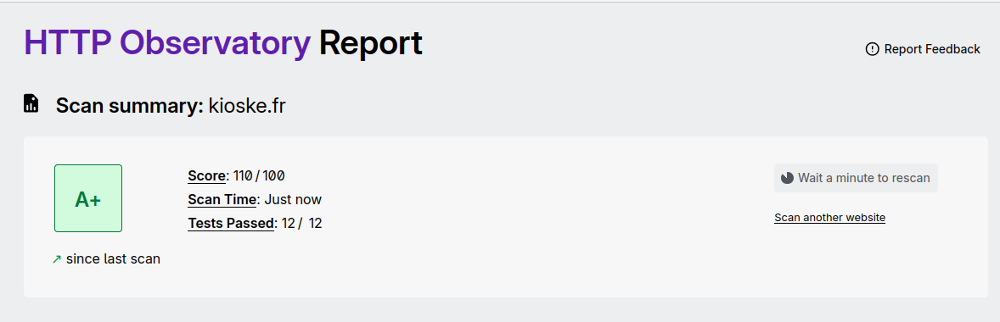
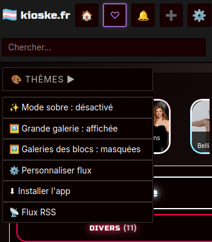

## 20/11/2026 :

### Matin 
- Ton accueil, à ta façon. Sur chaque titre de panneau ou de catégorie, un bouton 👁 : tu masques ce que tu ne veux pas voir, et les galeries se remplissent avec le reste. L'œil se ferme quand c'est masqué ; un second clic réaffiche. Un bandeau te permet de tout remettre.
- Les galeries par catégorie se choisissent. Elles sont masquées par défaut : active celles qui t'intéressent dans Paramètres, sous chaque panneau.
- sDans les galeries, les articles des médias français passent en premier, sans cacher les autres.
- Paramètres plus lisible. La page se déplie par sections, l'option active se voit en bleu, et les sous-menus sont distincts.
- Une nouvelle source : Biblio Anar, la bibliothèque anarchiste, avec ses derniers ajouts.
- Un doublon retiré dans la veille de Révolution Permanente.

### Tres tot le matin
- Hors connexion, les pages se gardent mieux. Une erreur du précache empêchait la mise en mémoire ; c'est corrigé.
- Dans les galeries de l'accueil, les articles des médias français passent en premier. Un article anglais, plus récent de quelques jours, peut toujours apparaître avant eux.
- **Une galerie par catégorie**, si vous voulez. Dans Paramètres, chaque catégorie a son interrupteur, rangé sous le titre de son panneau (LGBT, Médias Libre…). Elles sont masquées par défaut : activez celles qui vous intéressent.
- Paramètres plus lisible. La page est découpée en menus dépliants : Thème, Affichage, Flux, Installation, Notifications, Réinitialiser.
- Une option active se voit. Le bouton d'un réglage activé prend la même couleur que le survol, comme le thème choisi.
- Une nouvelle source : Biblio Anar, la bibliothèque anarchiste, avec ses derniers ajouts.
- Hors connexion, les pages se gardent mieux. Une erreur du précache empêchait les pages de se mettre en mémoire ; c'est corrigé.

## 19/11/2026 :

### Soir : 
- Resolution d'un bug sur les flux personnalise et la galerie. 
- Les sources françaises passent maintenant en premier dans les galeries de l'accueil. Les médias d'ici sont donc les premiers qu'on voit, sans rien retirer aux autres : elles arrivent en tête, puis le reste suit par date.
### Apres midi 
- GitHub à jour
- **Souci de deploiement, desole pour le ban de 5mn**
- Nouvelle galerie en haut de l'accueil : « Les + vus de la semaine », les 10 articles les plus lus ces 7 derniers jours, mise à jour toutes les 30 minutes. Un simple décompte des visites, sans aucun suivi des personnes.
- La galerie « Les derniers articles » a maintenant son titre, juste en dessous. Chaque galerie peut être masquée dans Paramètres.
- La recherche trouve les articles pendant que tu tapes, sans avoir besoin d'appuyer sur Entrée.
- Nouveau bouton « Tout remettre par défaut » dans Paramètres : thème, galeries, flux perso et notifications reviennent comme à ta première visite. Tes favoris sont gardés.
- Le Menu a sa propre adresse : kioske.fr/menu. Les anciens liens marchent toujours.
- App installée : un appui long sur l'icône donne des raccourcis vers la recherche, tes favoris, ton flux perso et le Menu.
- Sans connexion, le site affiche une page claire au lieu d'une erreur. Les pages déjà visitées restent lisibles.
- Corrections de sécurité sur le serveur.
- La galerie « Les derniers articles » est maintenant en premier, au-dessus de « Les + vus ».
- « Les + vus » compte aussi les articles que tu ouvres directement depuis un lien partagé.
- Quand tu ajoutes un article à tes favoris, le cœur ♡ pulse et des étoiles jaillissent autour de lui.
- Dans le Menu, les listes à sous-puces et les images sont mieux mises en page : les images sont centrées avec leur légende dessous, et les lignes vides que tu écris sont gardées.
- Thème trans : les titres des galeries et le nom « kioske.fr » sont en blanc, avec un halo bleu. Les favoris et les bords des panneaux ont maintenant du rose.

## 18/11/2026 :

## Soir 
- Un nouveau bouton Menu ☰ en haut à droite : il ouvre le menu du site, avec une page Paramètres pour choisir ton thème, le mode sobre, les galeries de l'accueil et ton flux personnalisé.
- La barre du haut est plus simple : clique sur « kioske.fr » pour revenir à l'accueil. Sur téléphone, tout tient sur une ligne.
- La cloche 🔔 garde tes notifications jusqu'à ce que tu les lises ou que tu cliques sur « Tout effacer ». Chaque notification t'emmène directement vers ce qu'elle annonce.
- Tu peux être prévenu·e des nouveautés du site : active « Me prévenir des changements du site » dans la cloche.
- Le site se charge plus vite d'une page à l'autre.
- Tuiles des sources plus lisibles : texte en gras, et survol rouge sur le thème par défaut.
- Thèmes néon : même transparence pour tous les panneaux.
- « Installer l'app » t'indique quoi faire si ton navigateur ne le permet pas.
- ajout d'un document de "la Horde" sur l'antifascime
- le site est maintenant plus sure. D'ou la panne de 5mn. Le temps du déploiement.  

### Pas le matin 

- Un nouveau document : le code de conduite est maintenant dans Ressources.
- Les nouveaux documents t'avertissent dans la cloche.
- L'accueil s'ouvre avec la grande galerie seule. Les galeries des catégories se rallument depuis le menu.
- Les nouveaux flux sont cochés pour toi dans ton flux perso.
- Thème trans : titres en blanc, reflets cyan, fond des panneaux plus sombre.
- Thèmes néon : les titres de panneaux brillent davantage.

### Matin 

- Creation de cette page pour communiquer sur le site.
- Création de paramètres personalisés
- Flux personnalisé : une notification quand un nouveau flux est ajouté au site. Un bandeau s'affiche sur l'accueil, avec le nom du flux. Il revient à chaque visite tant que tu ne l'as pas fermé. Un point rouge sur la cloche signale une notification en attente.
- Les notifications d'articles sont en pause pour le moment.
- Quatre flux remis dans la liste : Le Média, Info Libertaire (podcasts) et deux flux de Révolution Permanente.
- Thème prune : titres des catégories en blanc.
- Néons des titres plus intenses dans les thèmes néon.
- La cloche est toujours visible, même sans flux personnalisé. Son panneau propose d'activer les notifications des changements du site.
- Changements du site : quand un point est ajouté à cette page, tu reçois une notification (si elles sont activées), et un point rouge apparaît sur la cloche. Ouvrir le panneau affiche la mise à jour.
- Les notifications restent dans la liste « Mes notifications » jusqu'à « Tout effacer ». Ce bouton n'efface que les notifications : ton flux et tes réglages restent.

